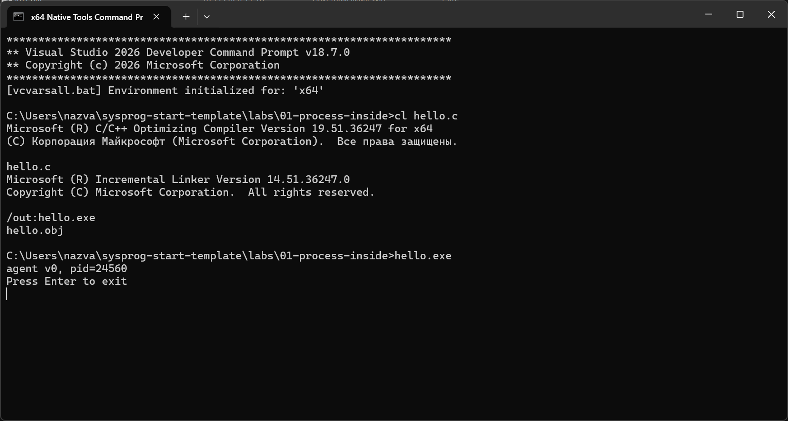
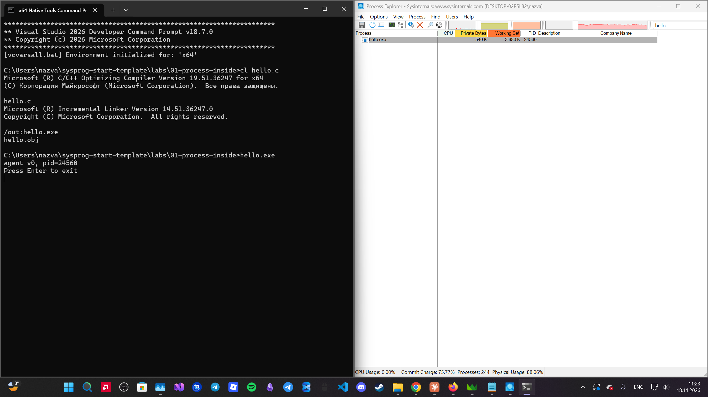
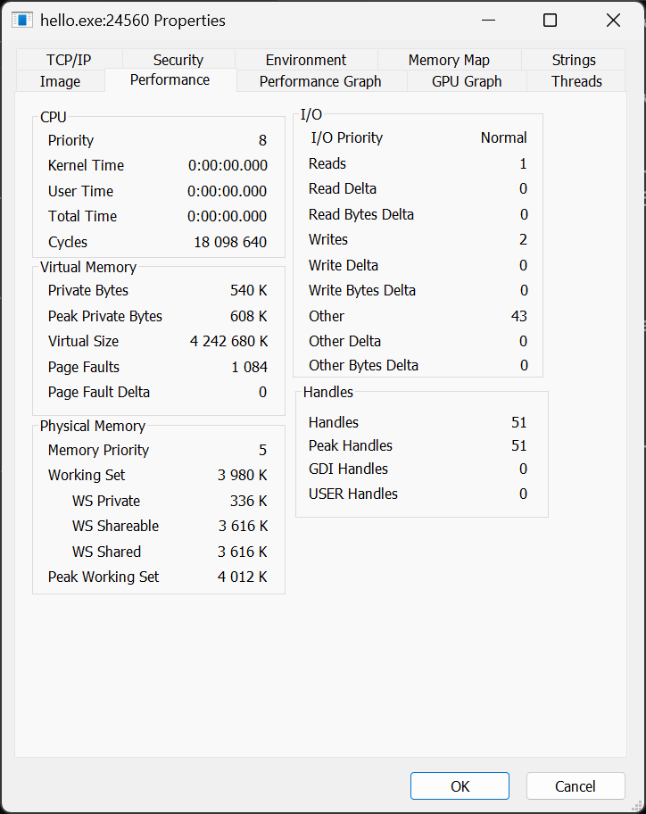
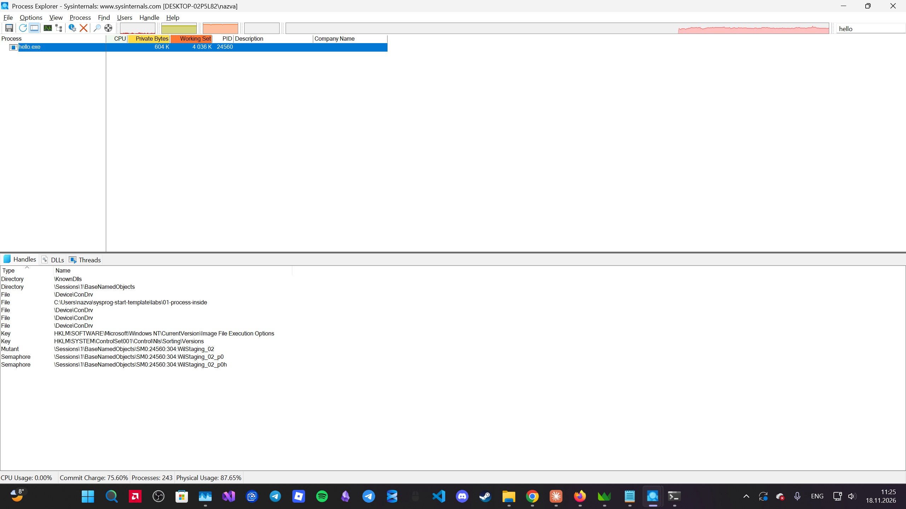
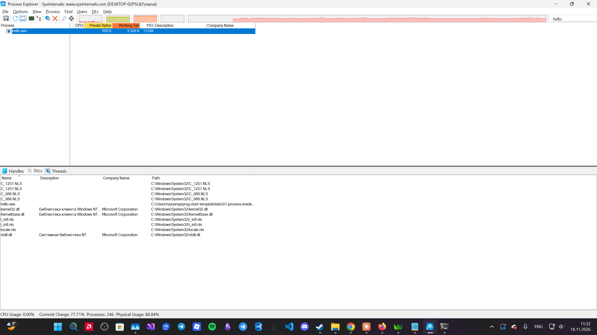
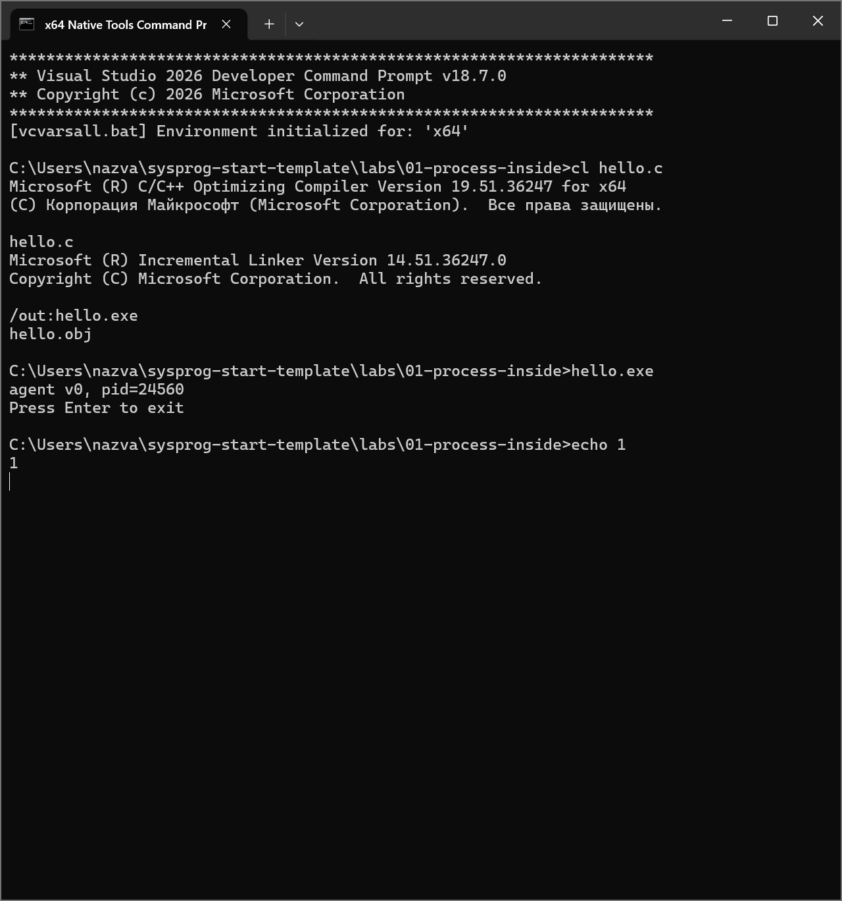
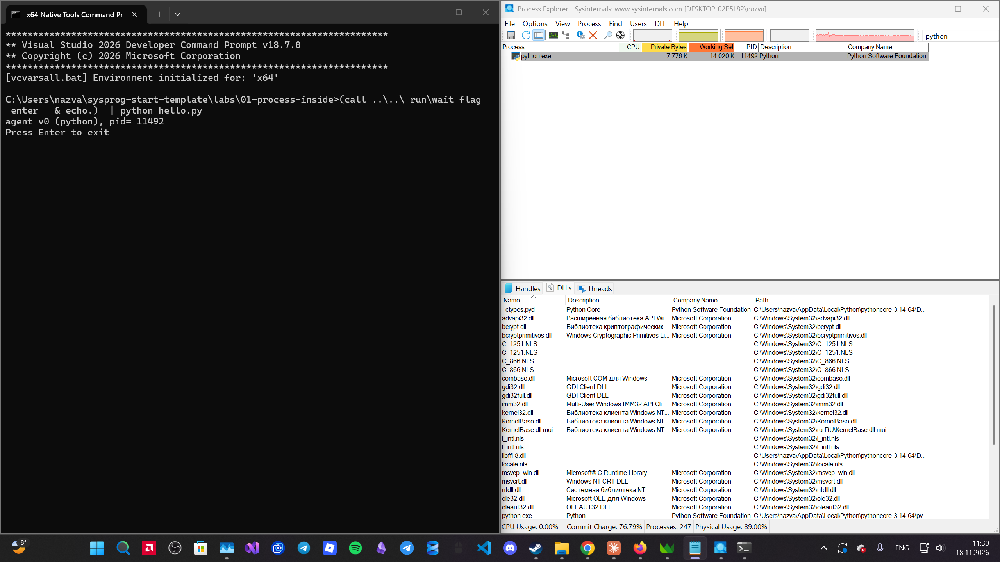
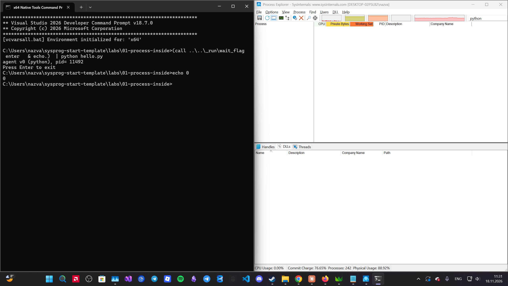

# ЛР 1. Процесс изнутри

Система: Windows 11 x64 (10.0.26200) · компилятор: Microsoft (R) C/C++ Optimizing Compiler Version 19.51.36247 for x64 (первая строка вывода версии)

## Программа на C
Программа напечатала PID 24560, монитор показал PID 24560.
Память процесса в мониторе: рабочий набор 3 980 КБ (Private Bytes 540 КБ). Процессорное время: 0:00:00.000 (Kernel Time 0, User Time 0, 18 098 640 тактов).
Пока программа ждёт Enter, процессорное время не растёт, потому что её единственный поток заблокирован в `getchar()` и ждёт ввода с консоли в ядре — планировщик не даёт ему процессор, пока не придёт строка.
Дескрипторов у процесса: 51. Ввод и вывод ведут в `\Device\ConDrv` — устройство консоли.
Системные библиотеки в процессе: ntdll.dll, kernel32.dll, KernelBase.dll (а также apphelp.dll и файлы локали C_1251.NLS, C_866.NLS, locale.nls).
После завершения из монитора терминал напечатал приглашение сразу после строки «Press Enter to exit», код завершения 1.

## Программа на Python
Имя процесса в мониторе: python.exe, PID 11492, память 14 036 КБ (рабочий набор; Private Bytes 7 684 КБ).
Памяти больше, чем у программы на C, примерно в 3,5 раза.
Общая библиотека у программ на C и Python: kernel32.dll (и KernelBase.dll, ntdll.dll).
Код завершения при обычном выходе: 0.

Не получилось: Диспетчер задач на этом компьютере запущен с правами администратора, поэтому поиск процесса, свойства и «Снять задачу» выполнены в Process Explorer (Kill Process) — номер, память и код завершения 1 те же. Enter для `hello.py` подавался через канал из командного файла (`(…& echo.) | python hello.py`). Снимок 05 сделан при повторном запуске `hello.exe` (PID 13168) — состав библиотек тот же.

ИИ: работа выполнена с помощью ИИ-ассистента Claude (запуск программ, снимки, заполнение отчёта).

## Снимки экрана

Сохраните снимок поверх заглушки в папке `screenshots/` с тем же именем — ссылки ниже менять не нужно.

### 1. Программа на C запущена
Шаг 1. Видно: команда сборки и строка `agent v0, pid=…` в терминале.

### 2. Свой процесс в мониторе
Шаг 3. Видно: строка процесса `hello` с тем же номером, что напечатала программа.

### 3. Свойства процесса
Шаг 4. Видно: окно процесса `hello`: номер, память, процессорное время.

### 4. Дескрипторы процесса
Шаг 5. Видно: открытые файлы или дескрипторы: папка программы и устройство терминала.

### 5. Библиотеки процесса
Шаг 6. Видно: загруженные библиотеки (в Linux — карта памяти).

### 6. Процесс завершён из монитора
Шаг 8. Видно: терминал после завершения: сообщение оболочки и код завершения.

### 7. Программа на Python в мониторе
Шаг 9. Видно: строка `agent v0 (python), pid=…` и процесс Python с тем же номером.

### 8. Обычный выход
Шаг 11. Видно: терминал после Enter: код завершения 0.

