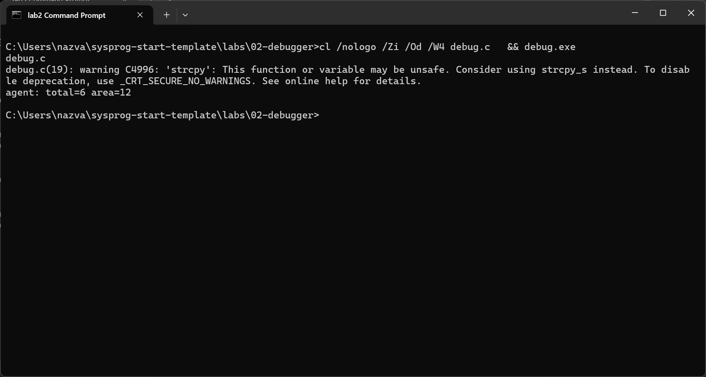
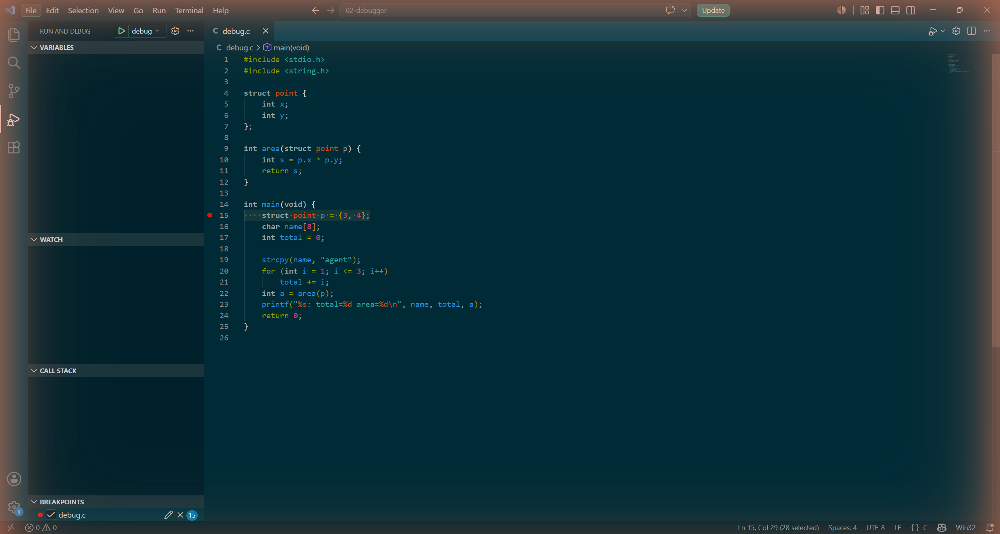
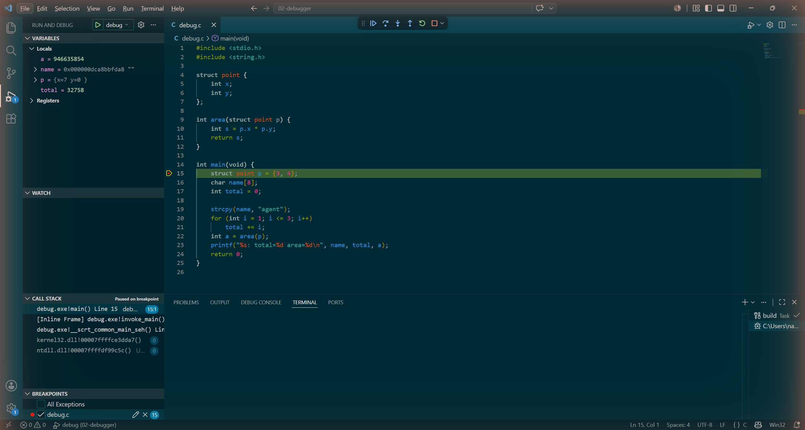
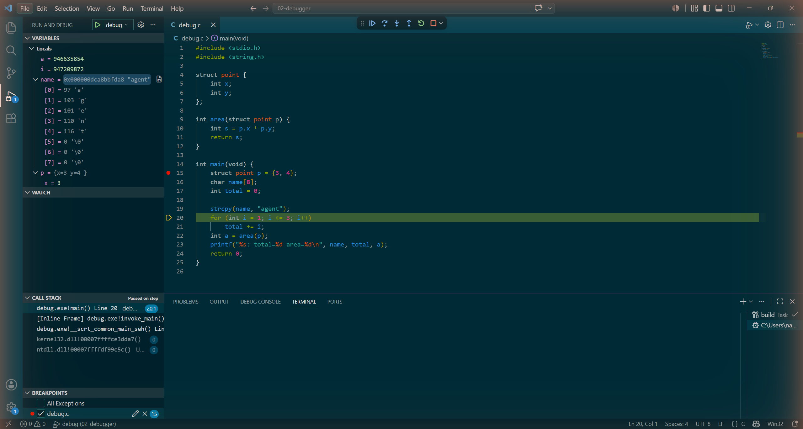
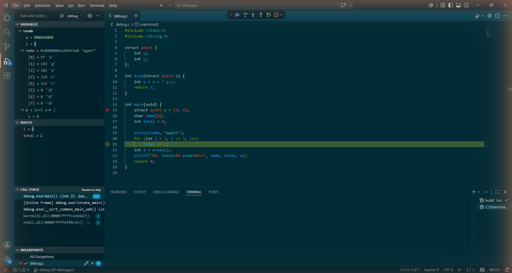
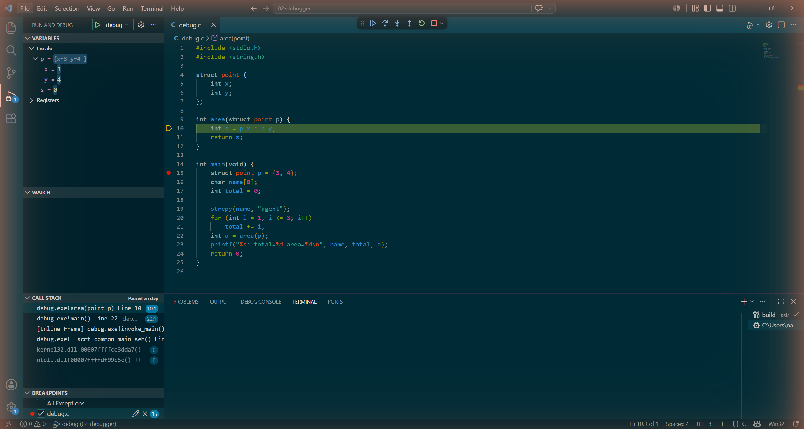
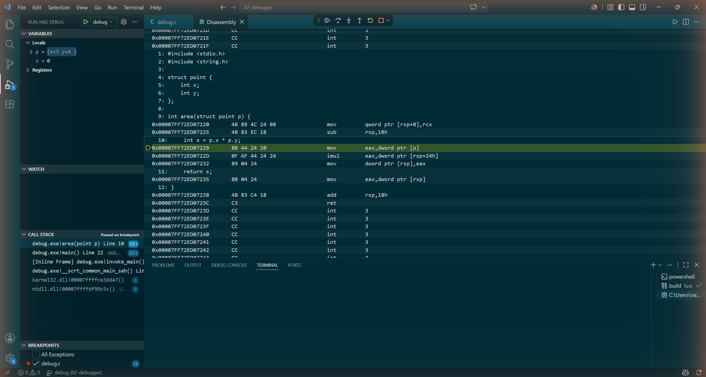
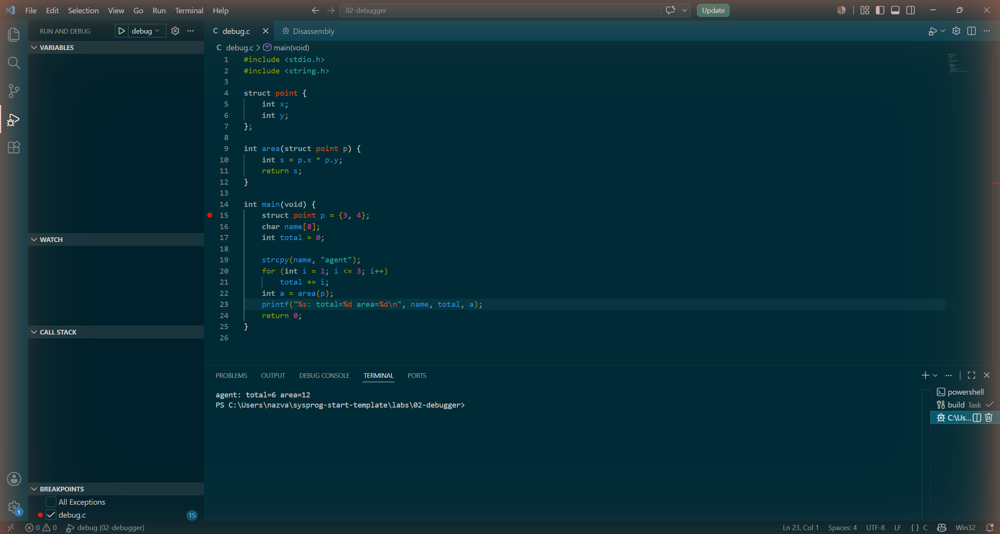

# ЛР 2. Программа в отладчике

Система: Windows 11 x64 (10.0.26200), AMD64 · отладчик: Visual Studio (cppvsdbg) в VS Code, расширение C/C++ 1.35.6, компилятор MSVC 19.51

## Остановка и переменные
Программа без отладчика напечатала: `agent: total=6 area=12` (и предупреждение C4996 для `strcpy` в строке 19)
Точка останова на строке 15.
До строки 15: p.x = 7, p.y = 0, total = 32758 (мусор из памяти; a = 946635854).
После строки 15: p.x = 3, p.y = 4.
Строку 16 отладчик пропустил, потому что `char name[8];` — только объявление массива без инициализации: для неё компилятор не создаёт ни одной машинной команды, место под массив уже выделено в кадре стека при входе в `main`.
name[0] = 97 (код буквы 'a'), завершающий ноль в ячейке [5] (ячейки [5]–[7] = 0 '\0').

## Цикл и функция
На кадре цикла: i = 2, total = 1; после следующего шага total = 3.
В стеке внутри area строк: 2 строки программы — `debug.exe!area(point p) Line 10` и `debug.exe!main() Line 22` (ниже ещё системные кадры invoke_main, __scrt_common_main_seh, kernel32.dll, ntdll.dll), сверху функция area.
Команда умножения в машинном коде: `imul eax,dword ptr [rsp+24h]` (вместе с `mov eax,dword ptr [p]` и `mov dword ptr [rsp],eax`).
Перед printf: a = 12, total = 6.
Код завершения программы: 0 (Debug Console: `The program '[1808] debug.exe' has exited with code 0 (0x0)`).

Не получилось: печатать и щёлкать правой кнопкой в VS Code ИИ не может, поэтому выражения `i` и `total` в Watch и «Open Disassembly View» добавлял пользователь; остальные шаги (точка останова, F5/F10/F11/Shift+F11 через панель отладки) выполнены кликами. Шаги 9–11 сделаны во втором запуске отладки (окно VS Code было закрыто): до строки 10 дошли через временную точку останова на строке 10, которую потом сняли. Код завершения 0 виден во вкладке Debug Console, вывод программы — во вкладке Terminal (снимок 08).

ИИ: работа выполнена с помощью ИИ-ассистента Claude (запуск команд и отладчика, снимки ShareX, заполнение отчёта).

## Снимки экрана

Сохраните снимок поверх заглушки в папке `screenshots/` с тем же именем — ссылки ниже менять не нужно.

### 1. Сборка и запуск без отладчика
Шаг 1. Видно: команда сборки и строка `agent: total=6 area=12`.

### 2. Точка останова
Шаг 3. Видно: красная точка у строки 15 и она же в списке Breakpoints.

### 3. Остановка перед строкой 15
Шаг 4. Видно: жёлтая стрелка у строки 15, переменные в Variables до присваивания.

### 4. Массив name по ячейкам
Шаг 6. Видно: раскрытый `name`: буквы `agent` и ноль в `[5]`.

### 5. Цикл в Watch
Шаг 7. Видно: `i` и `total` в разделе Watch на втором проходе цикла.

### 6. Внутри функции area
Шаг 8. Видно: стрелка в `area`, копия `p` в Variables, две строки в Call Stack.

### 7. Машинный код строки 10
Шаг 9. Видно: вкладка Disassembly с командой умножения.

### 8. Программа доработала
Шаг 11. Видно: вывод программы под отладчиком и код завершения.

