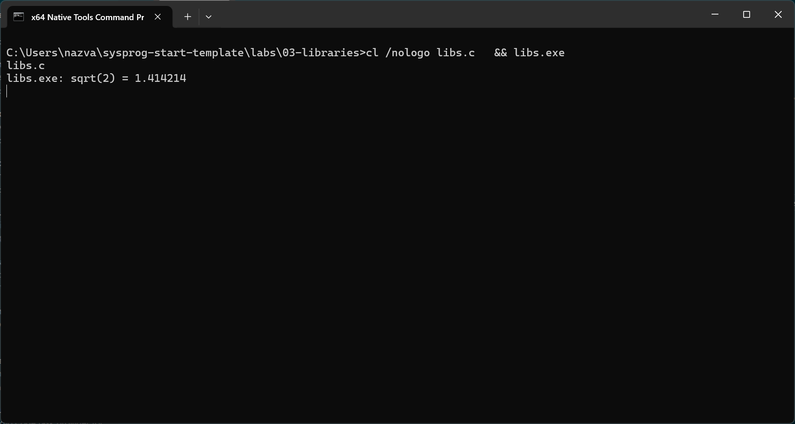
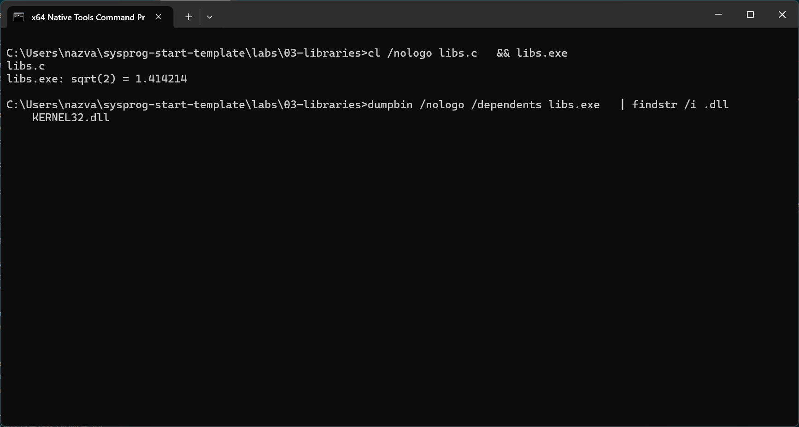
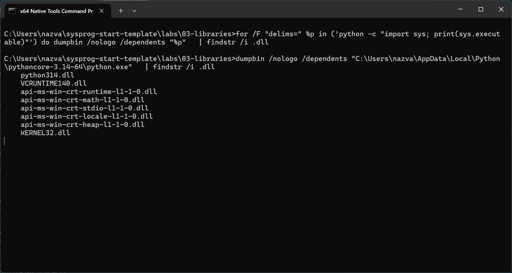
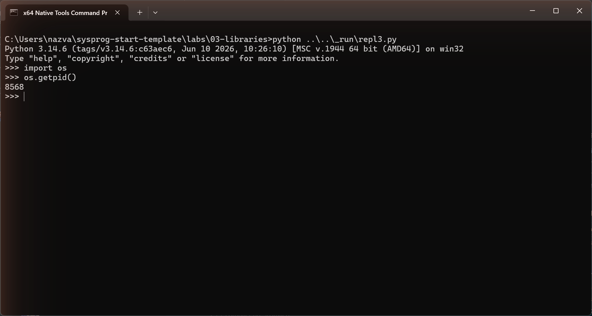
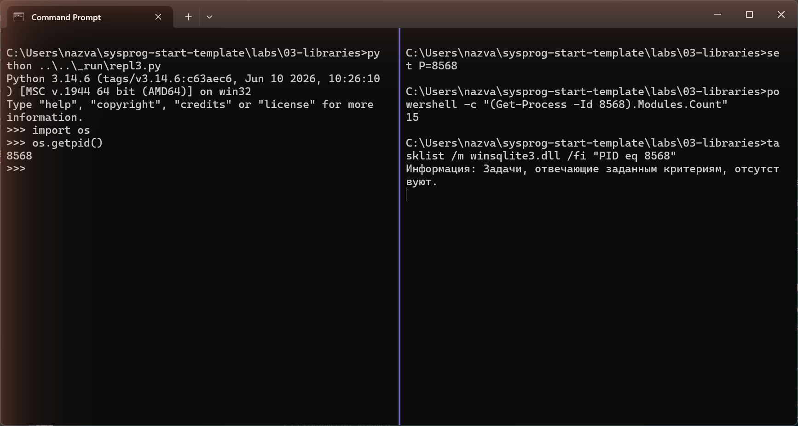
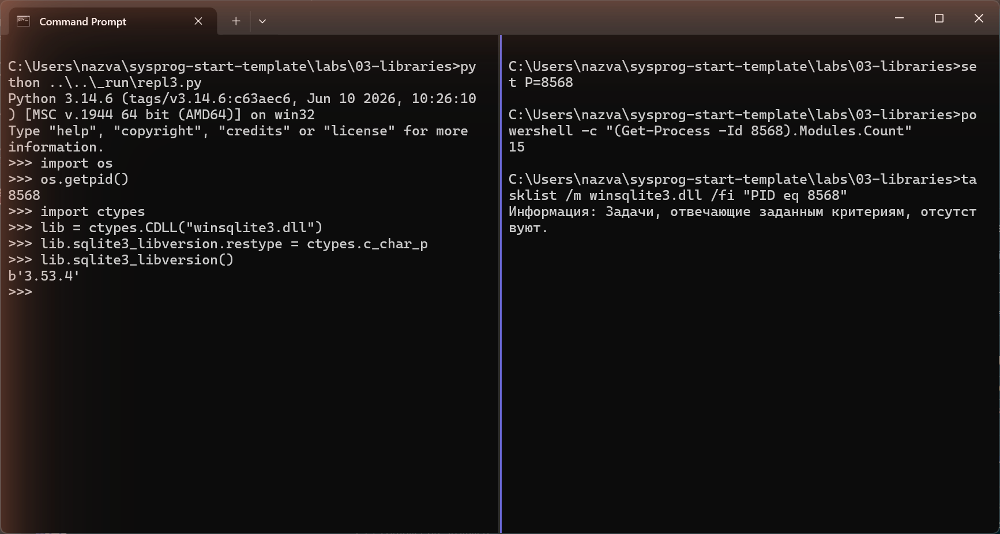
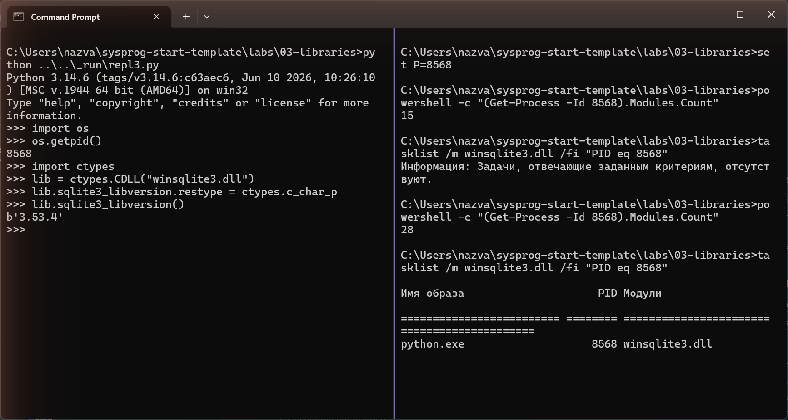

# ЛР 3. Библиотеки программы

Система: Windows 11 x64 (10.0.26200), процессор AMD64 · компилятор MSVC 19.51 (x64 Native Tools Command Prompt for VS)

## Библиотеки файла
Программа напечатала: `libs.exe: sqrt(2) = 1.414214`
Команда для списка библиотек файла: `dumpbin /nologo /dependents libs.exe | findstr /i .dll`
Библиотеки libs: KERNEL32.dll (одна библиотека)
Почему в списке нет отдельной математической библиотеки (или почему она есть): MSVC по умолчанию собирает со статической библиотекой C (`/MT`, libcmt), поэтому нужный код `sqrt` и `printf` копируется прямо в `libs.exe`; из системы программе нужен только KERNEL32.dll.
Где лежит интерпретатор Python (файл или библиотека): в библиотеке `python314.dll` — сам `python.exe` маленький и зависит от python314.dll, VCRUNTIME140.dll, api-ms-win-crt-*.dll и KERNEL32.dll.

## Библиотеки процесса
PID Python: 8568
Библиотек в процессе до ctypes.CDLL: 15, после: 28
Загруженная библиотека и её полный путь: winsqlite3.dll — `C:\Windows\System32\winsqlite3.dll`
Функция вернула: `b'3.53.4'`

Не получилось: команды выполнялись в Windows Terminal (две панели, как Split Terminal в VS Code), а не во встроенном терминале VS Code. Сеанс Python для шагов 4–7 запущен через `python ..\..\_run\repl3.py`: это настоящий интерпретатор (`code.InteractiveConsole`), строки `import os`, `ctypes.CDLL(...)` и т. д. подаются в него из скрипта и печатаются с приглашением `>>>`. После загрузки стало на 13 модулей больше: кроме winsqlite3.dll подгрузились модуль `_ctypes` и его зависимости (libffi и др.).

ИИ: работа выполнена с помощью ИИ-ассистента Claude (запуск команд, снимки ShareX, заполнение отчёта).

## Снимки экрана

Сохраните снимок поверх заглушки в папке `screenshots/` с тем же именем — ссылки ниже менять не нужно.

### 1. Сборка и запуск
Шаг 1. Видно: команда сборки и строка `sqrt(2) = 1.414214`.

### 2. Библиотеки файла libs
Шаг 2. Видно: вывод `dumpbin /dependents` / `otool -L` / `ldd` для своей программы.

### 3. Библиотеки интерпретатора Python
Шаг 3. Видно: тот же вывод для файла Python.

### 4. Номер процесса Python
Шаг 4. Видно: запущенный Python и его номер процесса.

### 5. Библиотеки процесса до загрузки
Шаг 5. Видно: число библиотек процесса Python до `ctypes.CDLL`.

### 6. Библиотека загружена
Шаг 6. Видно: строка `ctypes.CDLL` и результат вызова функции библиотеки.

### 7. Библиотеки процесса после загрузки
Шаг 7. Видно: новое число библиотек и строка загруженной библиотеки.

