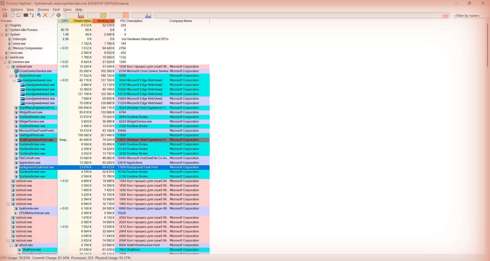
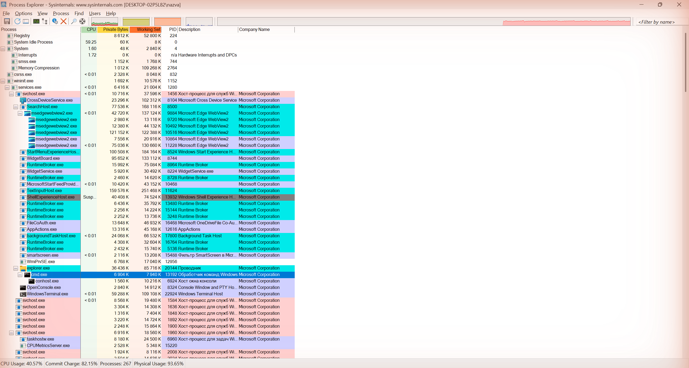
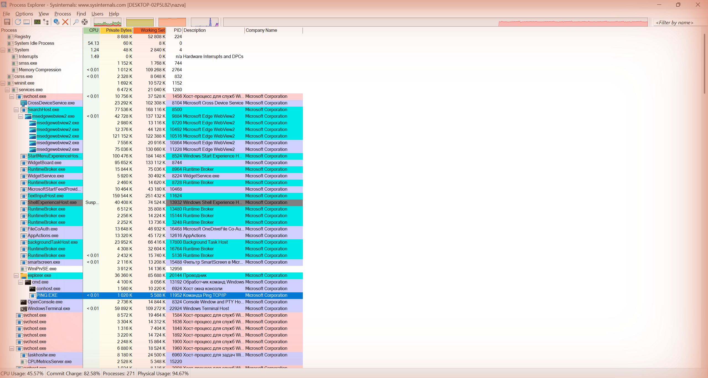
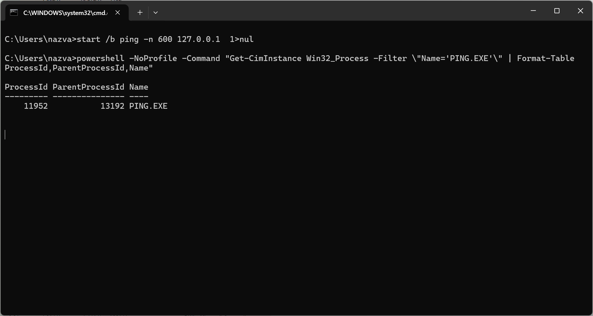
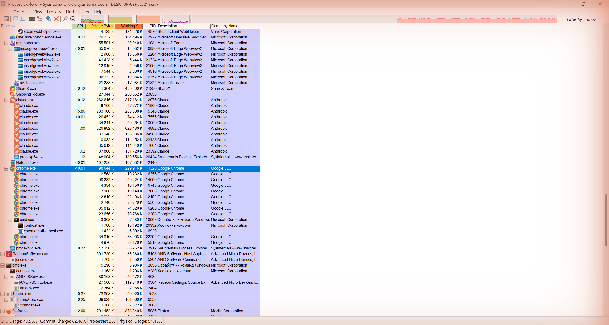
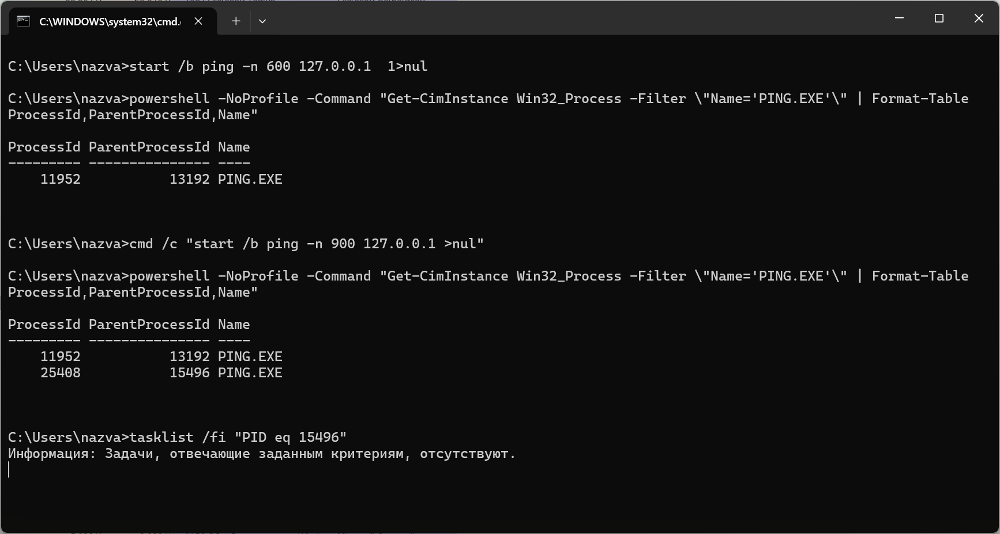
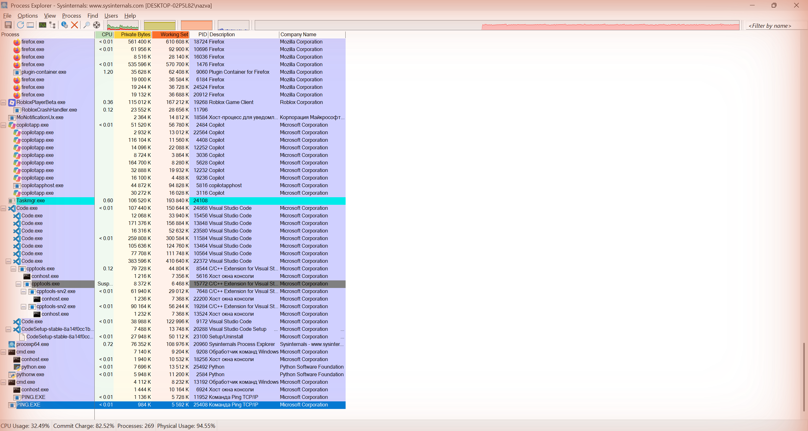

# ЛР 4. Дерево процессов

Система: Windows 11 x64 (10.0.26200) · монитор: Process Explorer (procexp64.exe, Sysinternals)

## Дерево
Процесс в начале дерева и его номер: System Idle Process (0), за ним System (4); дальше wininit.exe (1152) → services.exe (1280) → svchost.exe с дочерними процессами
Цепочка родителей терминала (имя и номер): cmd.exe (13192) ← explorer.exe (20144) ← svchost.exe (1456) ← services.exe (1280) ← wininit.exe (1152); под cmd.exe — conhost.exe (6924)
Дочерний процесс: номер 11952 (PING.EXE), родитель 13192 (cmd.exe)
Команда, которой проверен родитель: `powershell -NoProfile -Command "Get-CimInstance Win32_Process -Filter \"Name='PING.EXE'\" | Format-Table ProcessId,ParentProcessId,Name"`
Процессов у браузера и имя процесса вкладок: Google Chrome — главный chrome.exe (11320) и 10 дочерних chrome.exe (из них 6 с `--type=renderer` — это процессы вкладок, остальные: gpu-process, 2 utility, crashpad-handler); вкладки — тоже chrome.exe

## Сирота
Номер сироты: 25408 (PING.EXE)
Номер родителя до и после завершения настоящего родителя: 15496 и 15496 — ParentProcessId не меняется, хотя процесса 15496 уже нет (`tasklist /fi "PID eq 15496"` — задачи отсутствуют)
Где сирота стоит в дереве: у левого края, на верхнем уровне в конце списка — его родителя в списке нет

Не получилось: терминал открыт не через Win+R, а командой `explorer.exe lab4.bat` (команды подавал ИИ из командного файла), поэтому родитель cmd.exe — отдельный процесс explorer.exe (20144), запущенный от svchost.exe, а не основной explorer.exe рабочего стола. Через минуту этот explorer.exe завершился, и на снимке 07 cmd.exe (13192) тоже стоит у левого края, но первый PING.EXE (11952) по-прежнему под ним. В качестве браузера — Chrome вместо Edge.

ИИ: работа выполнена с помощью ИИ-ассистента Claude (запуск команд, снимки ShareX, заполнение отчёта).

## Снимки экрана

Сохраните снимок поверх заглушки в папке `screenshots/` с тем же именем — ссылки ниже менять не нужно.

### 1. Начало дерева процессов
Шаг 1. Видно: дерево процессов в мониторе: первые процессы системы и их номера.

### 2. Терминал и его родители
Шаг 2. Видно: ветка дерева от процесса терминала вверх до процесса системы.

### 3. Дочерний процесс терминала
Шаг 3. Видно: запущенный из терминала процесс под оболочкой терминала.

### 4. Родитель по команде
Шаг 4. Видно: вывод команды с номером процесса и номером его родителя.

### 5. Процессы браузера
Шаг 5. Видно: раскрытая ветка браузера с дочерними процессами.

### 6. Процесс без родителя
Шаг 6. Видно: команда запуска и номер родителя у оставшегося процесса.

### 7. Сирота в дереве
Шаг 7. Видно: тот же процесс в дереве монитора на новом месте.

