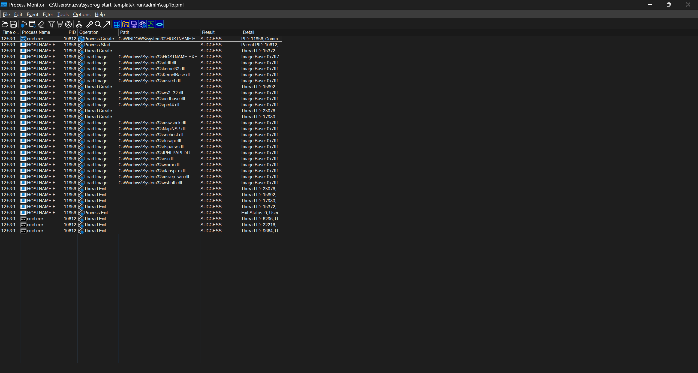
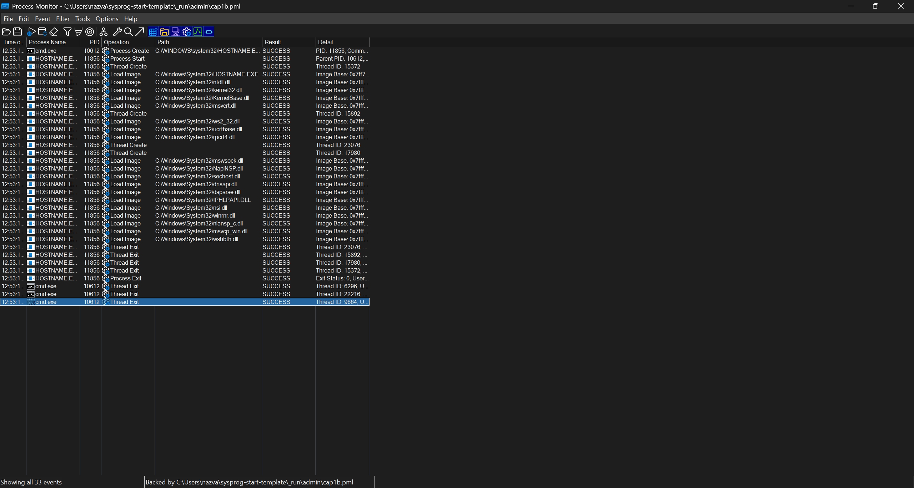
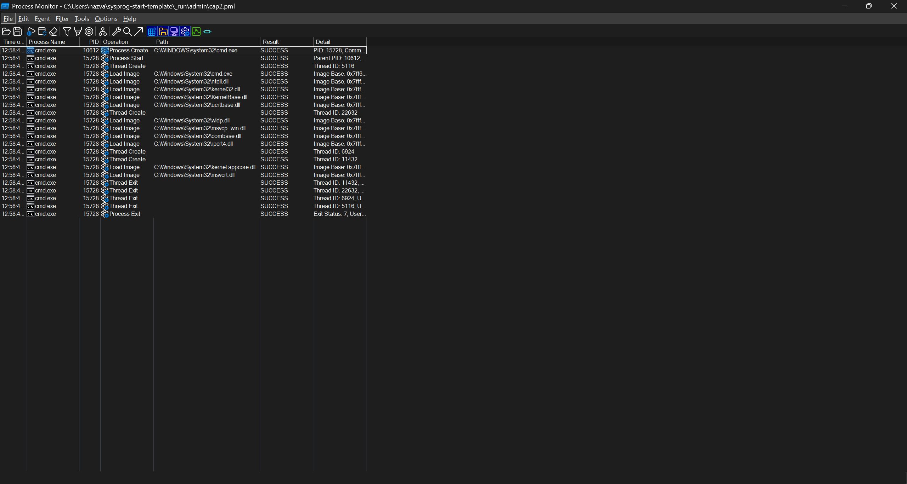
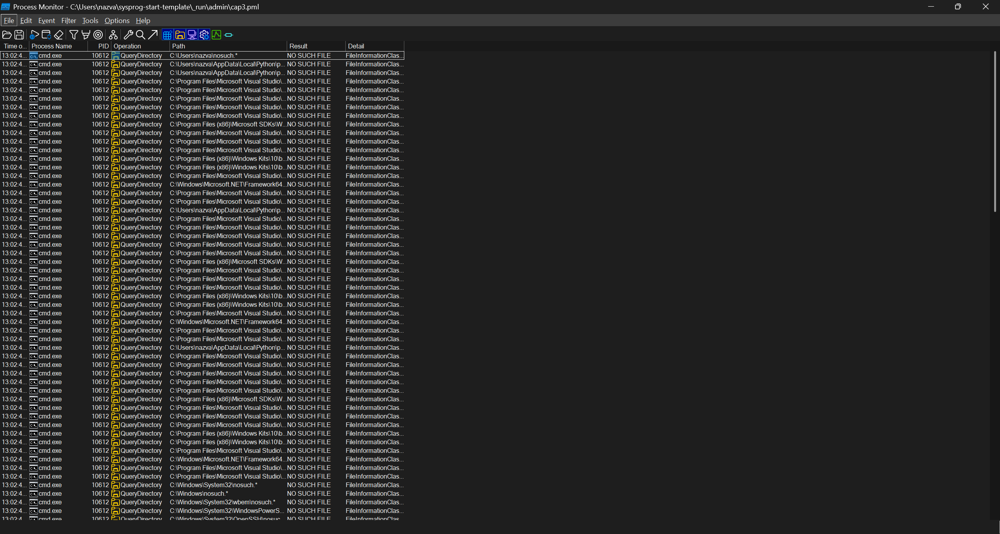
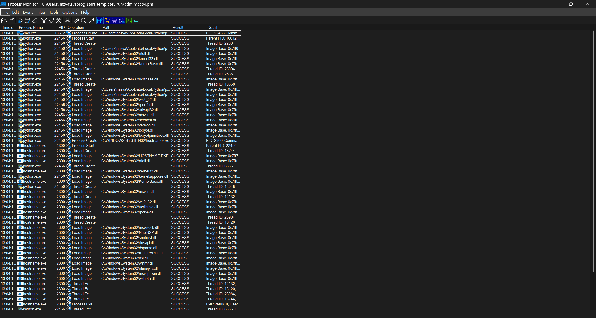

# ЛР 5. Рождение процесса

Система: Windows 11 x64 (10.0.26200), процессор x64 (AMD64)
Программа записи: Process Monitor (Procmon64.exe, Sysinternals), фильтр: Process Name is HOSTNAME.EXE / cmd.exe / python.exe, Event Class is Process

## Рождение
Родитель (имя и номер): cmd.exe, PID 10612
Номер нового процесса: 11856 (HOSTNAME.EXE; в Detail события `Process Create`: `PID: 11856, Command line: hostname`)
Событие или вызов, которым создан процесс: событие `Process Create` у родителя cmd.exe (вызов `CreateProcessW`), у ребёнка — `Process Start` с `Parent PID: 10612`
Библиотек загружено и первая из них: 19 строк `Load Image` у HOSTNAME.EXE — сам HOSTNAME.EXE и 18 библиотек; первая библиотека — ntdll.dll (далее kernel32.dll, KernelBase.dll, msvcrt.dll, ws2_32.dll …)

## Завершение
Код завершения у ребёнка и у родителя: у ребёнка cmd.exe (PID 15728) `Process Exit` — `Exit Status: 7`; у родителя `echo code %errorlevel%` напечатал `code 7`
Программа nosuch: папок проверено 36 (154 операции `QueryDirectory` по шаблону `nosuch.*` — текущая папка и все папки из PATH), ошибка NO SUCH FILE, код 9009 («"nosuch" не является внутренней или внешней командой…»)

## Запуск из Python
Номер Python и номер ребёнка: python.exe — PID 22456 (родитель cmd.exe 10612), hostname.exe — PID 2300 (`Process Start`: `Parent PID: 22456`); Python напечатал `code 0`
Чем запуск из Python отличается от запуска из оболочки: по сути ничем — `subprocess.run` в Windows делает тот же системный вызов `CreateProcessW`, что и cmd.exe; в журнале видно то же событие `Process Create`, только родителем стал python.exe, а вывод ребёнка Python забрал себе (`capture_output=True`) вместо того, чтобы показать его в окне

Не получилось: Process Monitor запускался из командной строки с правами администратора (`Procmon64 /BackingFile … /LoadConfig …`, затем `/Terminate` и `/OpenLog`) — по окнам с повышенными правами ИИ кликать не может, поэтому фильтр задан файлом конфигурации, а не через Ctrl+L. В окне командной строки PATH включал папки Visual Studio, поэтому папок, где cmd искал `nosuch`, получилось 36, а не 11.

ИИ: работа выполнена с помощью ИИ-ассистента Claude (запуск команд, снимки ShareX, заполнение отчёта).

## Снимки экрана

Сохраните снимок поверх заглушки в папке `screenshots/` с тем же именем — ссылки ниже менять не нужно.

### 1. Рождение процесса
Шаг 1. Видно: запись запуска `hostname`: родитель создаёт процесс, у нового процесса номер родителя.

### 2. Библиотеки нового процесса
Шаг 2. Видно: библиотеки, которые загрузил `hostname`, и первая из них.

### 3. Код завершения 7
Шаг 3. Видно: завершение ребёнка с кодом 7 и тот же код у родителя.

### 4. Программы нет
Шаг 4. Видно: поиск `nosuch` по папкам из PATH и ошибка «не найдено».

### 5. Запуск из Python
Шаг 5. Видно: Python создаёт процесс `hostname`: номер Python и номер ребёнка.

