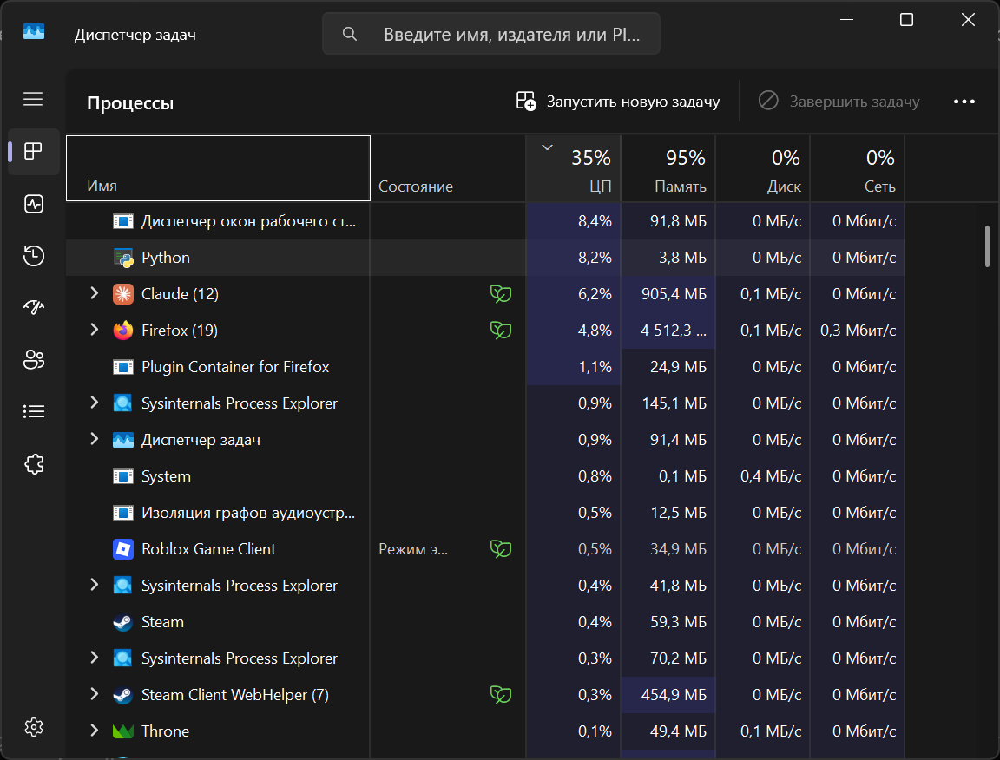
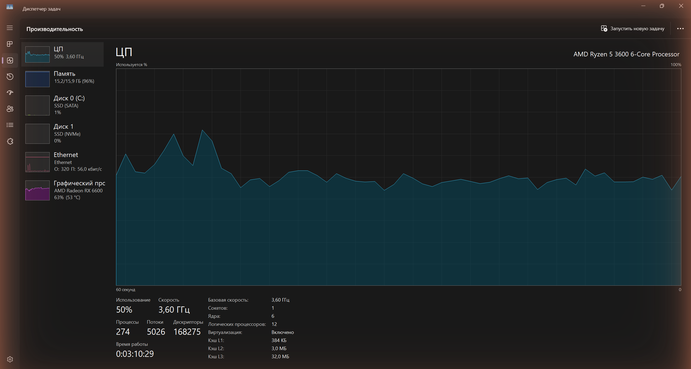
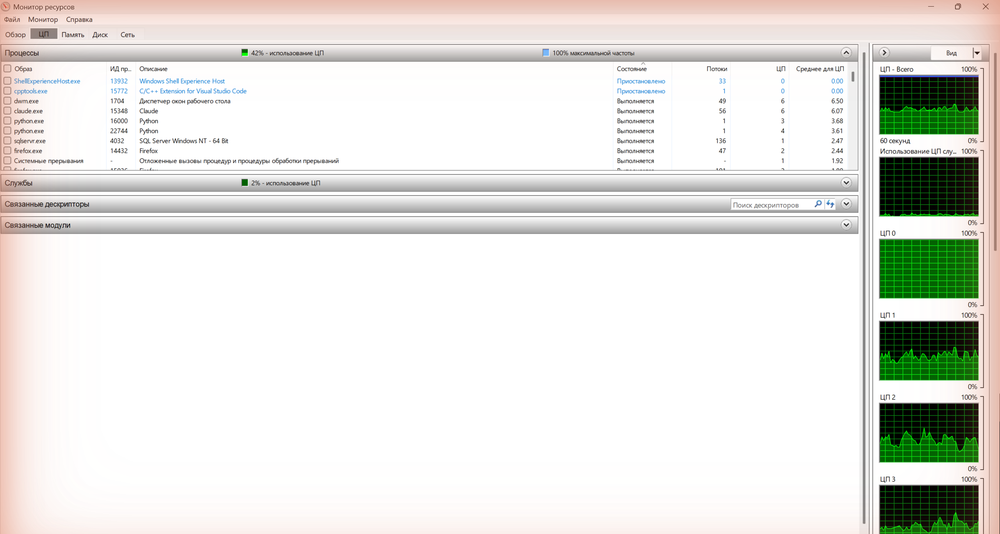
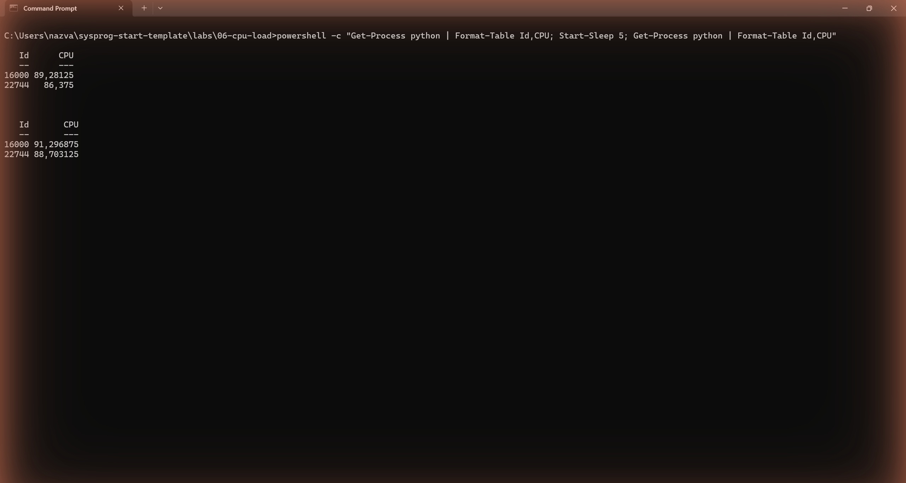

# ЛР 6. Кто загружает процессор

Система: Windows 11 x64 (10.0.26200), AMD Ryzen 5 3600 6-Core Processor, 3,60 ГГц
Ядер (логических процессоров): 12 (6 физических ядер, 1 сокет)

## Одна нагрузка
Процент процесса в мониторе: Python — 8,2% (одно ядро из 12 = 1/12 ≈ 8,3% шкалы)
Общая загрузка: 35% (на компьютере работали и другие программы — браузеры, Claude)
На каких ядрах видна нагрузка: в «Мониторе ресурсов» графики ЦП 0, ЦП 1, ЦП 2, ЦП 3 … рваные, ни один не стоит ровно на 100% — Windows всё время пересаживает поток программы с ядра на ядро, поэтому нагрузка размазана по всем графикам

## Две нагрузки
Проценты обеих нагрузок и общая загрузка: Python 8,2% и 8,1% (по одному ядру каждая), общая загрузка 49–50% на вкладке «Производительность»
На одном ядре (в macOS — фоновый режим): после `start /b /affinity 1` обе программы получают по ≈ 4% всей шкалы (в «Мониторе ресурсов» «Среднее для ЦП» 3,68 и 3,61 и растёт к 4,2 = половина ядра), график «ЦП 0» — сплошная полоса на 100%, общая загрузка 42%. Ядро 1 и остальные простаивают для них, потому что маска сходства `1` (двоичное 0001) разрешает обеим программам только ядро 0 — планировщик делит его пополам между ними и не может переселить их на свободные ядра

## Процессорное время
Первый замер, второй замер, пауза: PID 16000: 89,28125 с → 91,296875 с; PID 22744: 86,375 с → 88,703125 с; пауза 5 с
Загрузка по замерам: (91,296875 − 89,28125) / 5 ≈ 0,40 → ≈ 40% одного ядра; для второй (88,703125 − 86,375) / 5 ≈ 0,47 → ≈ 47%; вместе ≈ 87% ядра 0 — по половине ядра на каждую
Почему процент в мониторе не говорит о скорости работы: процент — это доля времени, когда ядро было занято потоком программы, а не объём сделанной работы. Пустой цикл `while True: pass` держит ядро на 100%, но ничего полезного не делает; а при общем ядре две программы получают по половине времени и каждая работает вдвое медленнее, хотя монитор просто показывает «занято»

Не получилось: «Диспетчер задач» и «Монитор ресурсов» работают с повышенными правами, и ИИ не мог по ним кликать — сортировку по ЦП, вкладку «Производительность» и вкладку «ЦП» в «Мониторе ресурсов» переключал пользователь. На снимке 02 видна вкладка «Производительность» (использование 50%, 12 логических процессоров); два процесса Python с 8,2% и 8,1% были видны на вкладке «Процессы» перед этим. Шаг 6: программы остановлены командой `taskkill`, графики вернулись к фоновой нагрузке.

ИИ: работа выполнена с помощью ИИ-ассистента Claude (запуск команд, снимки ShareX, заполнение отчёта).

## Снимки экрана

Сохраните снимок поверх заглушки в папке `screenshots/` с тем же именем — ссылки ниже менять не нужно.

### 1. Одна нагрузка
Шаг 1. Видно: процесс Python в мониторе: его процент и общая загрузка.

### 2. Две нагрузки
Шаг 3. Видно: два процесса Python и загрузка ядер.

### 3. Нагрузки на одном ядре
Шаг 4. Видно: две нагрузки на одном ядре и их проценты; в macOS — два числа оборотов цикла.

### 4. Процессорное время
Шаг 5. Видно: два замера процессорного времени с паузой между ними.

