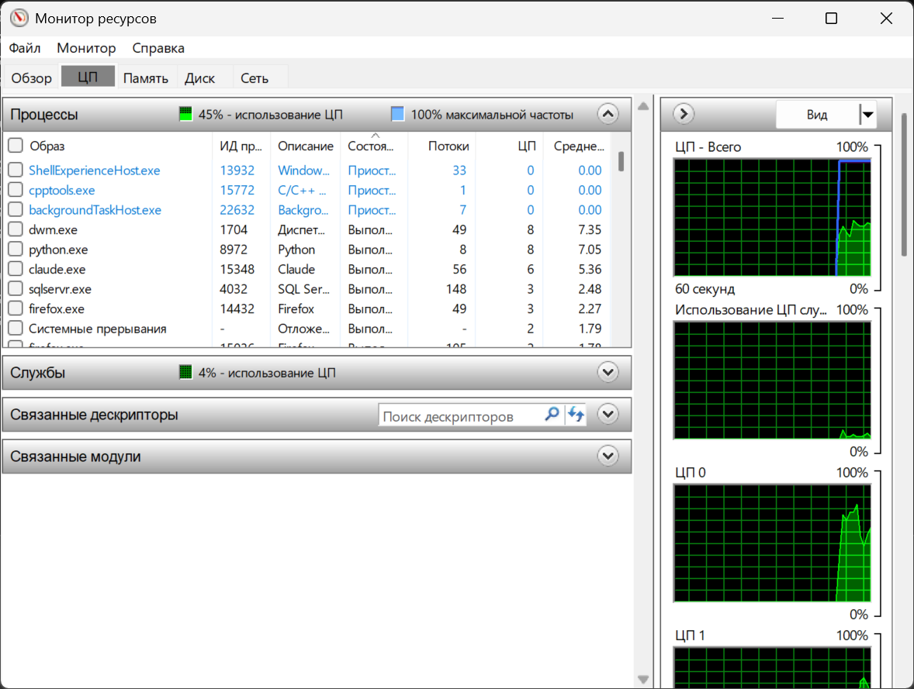
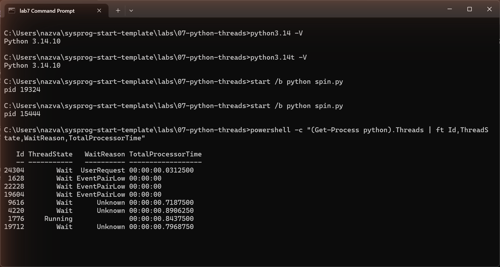
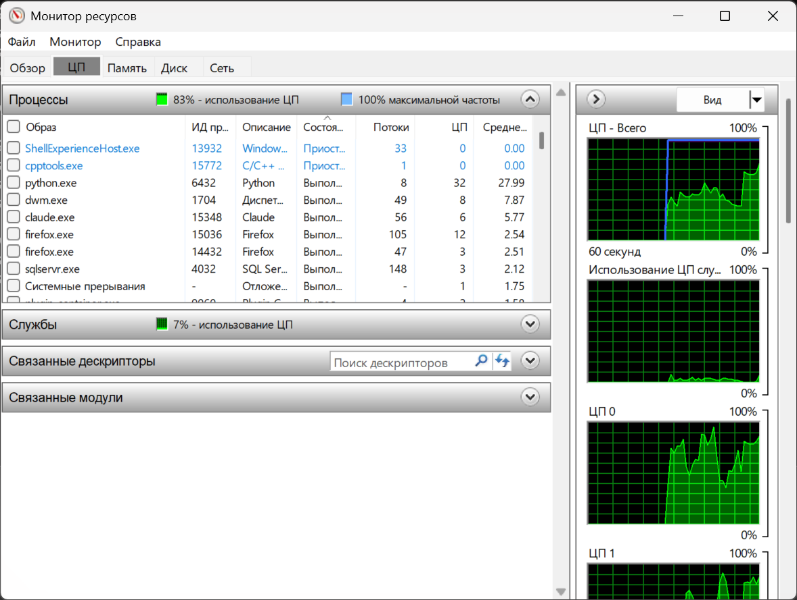
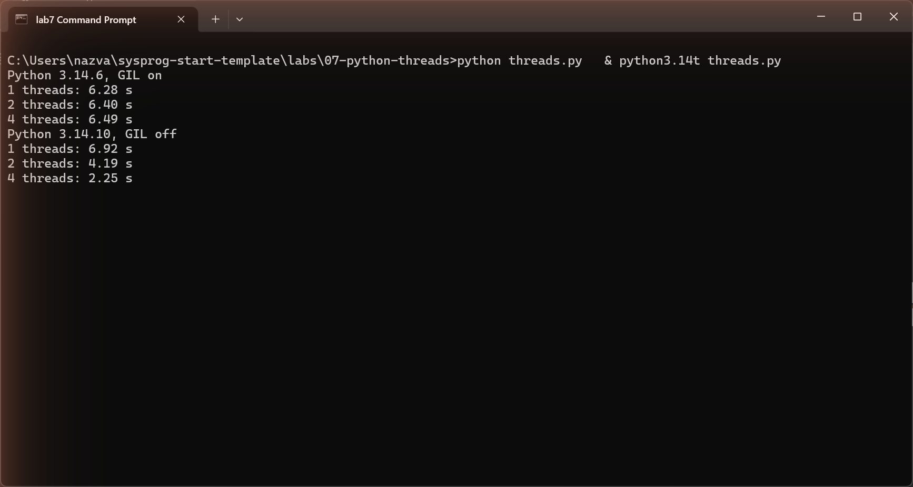

# ЛР 7. Потоки Python и GIL

Система: Windows 11 x64 (10.0.26200), AMD Ryzen 5 3600 6-Core Processor
Ядер (логических процессоров): 12 (6 физических ядер)
Версии Python (обычный и без GIL): `python3.14 -V` → Python 3.14.10, `python3.14t -V` → Python 3.14.10 (free-threaded, установлены через `uv python install 3.14 3.14t`); команда `python` в работе — Python 3.14.6 с python.org

## Python с GIL
Процент процесса и число потоков: python.exe (PID 8972) — 8% ЦП в «Мониторе ресурсов» (среднее 7,05), потоков 8 (главный + 4 рабочих + служебные). 8% — это ровно одно ядро из 12: из-за GIL четыре рабочих по очереди занимают одно ядро
Сколько потоков выполняется одновременно: один — в таблице потоков ровно один рабочий в состоянии `Running`, остальные в `Wait`; у рабочих близкое TotalProcessorTime (0,72 / 0,89 / 0,84 / 0,80 с) — они делят одно ядро по очереди

## Python без GIL
Процент процесса и проценты потоков: python.exe (PID 6432, запущен оболочкой uv `python3.14t.exe` PID 6340) — 32% ЦП (среднее 27,99), 8 потоков; 32% из 12 ядер ≈ 4 полностью занятых ядра, то есть каждый из 4 рабочих потоков занимает своё ядро ≈ 100%. За ~7 с процесс набрал 28,6 с процессорного времени (≈ 4 ядра одновременно)

## Время работы
С GIL, 1 / 2 / 4 потока: 6,28 с / 6,40 с / 6,49 с
Без GIL, 1 / 2 / 4 потока: 6,92 с / 4,19 с / 2,25 с
Без GIL с PYTHON_GIL=1: 6,62 с / 6,64 с / 6,52 с — ускорение пропало
Ожидание, 1 и 4 потока: 2,00 с и 2,00 с
Почему ожидающие потоки ускоряются и с GIL: поток, который ждёт (`time.sleep`, ввод-вывод), отпускает GIL на время ожидания, и интерпретатор отдаёт его другим потокам. Четыре потока спят одновременно, процессор им почти не нужен, поэтому 4 × 2 с укладываются в 2 с даже с GIL. GIL мешает только потокам, которые всё время считают на процессоре

Не получилось: `python3.14t` от uv — это небольшая программа-оболочка: в мониторе видна строка python.exe (настоящий интерпретатор без GIL, дочерний процесс python3.14t.exe), а сам `python3.14t.exe` почти не занимает процессор; поэтому `(Get-Process python3.14t).Threads` показывает потоки оболочки, а не рабочих. Процессоров 12, а не 4, поэтому проценты в мониторе в три раза меньше, чем в методичке («Монитор ресурсов» открывал и переключал пользователь — у ИИ нет доступа к окнам с повышенными правами). Для снимков 01 и 03 spin.py запускался повторно (каждый запуск работает 15 с).

ИИ: работа выполнена с помощью ИИ-ассистента Claude (запуск команд, снимки ShareX, заполнение отчёта).

## Снимки экрана

Сохраните снимок поверх заглушки в папке `screenshots/` с тем же именем — ссылки ниже менять не нужно.

### 1. Четыре потока с GIL
Шаг 1. Видно: процесс Python в мониторе: его процент и число потоков.

### 2. Потоки процесса
Шаг 2. Видно: список потоков процесса: сколько выполняется, сколько ждёт.

### 3. Четыре потока без GIL
Шаг 3. Видно: процесс python3.14t в мониторе: его процент.

### 4. Время работы
Шаг 4. Видно: вывод threads.py в Python с GIL и без.

