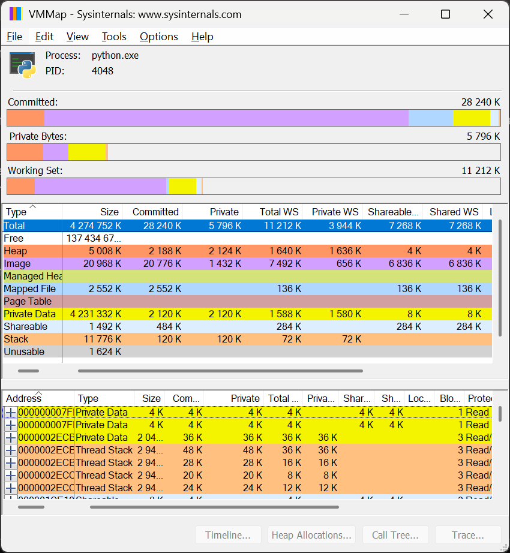
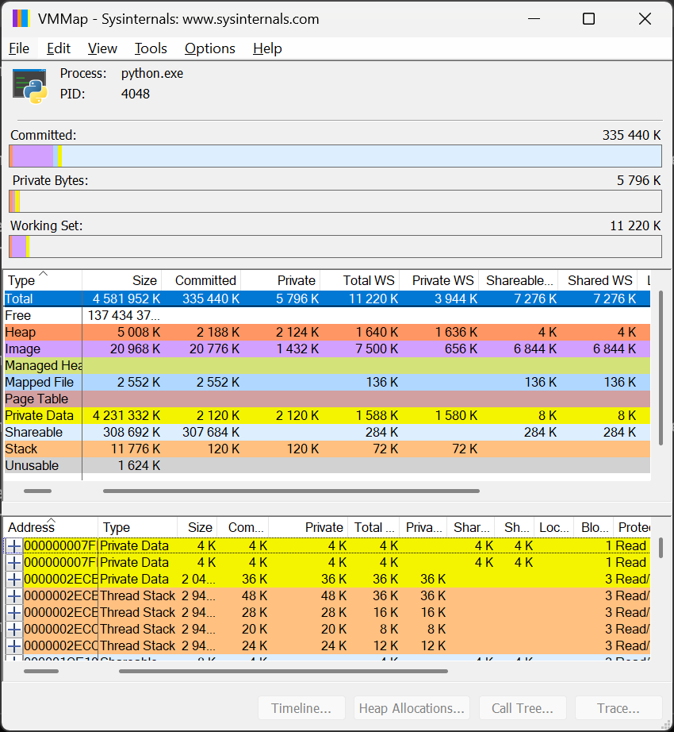
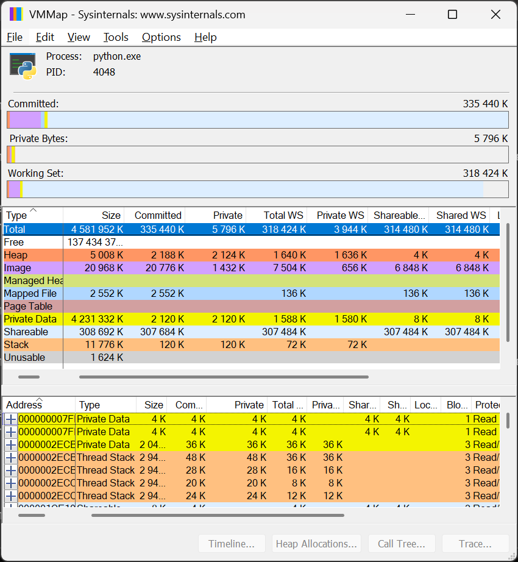
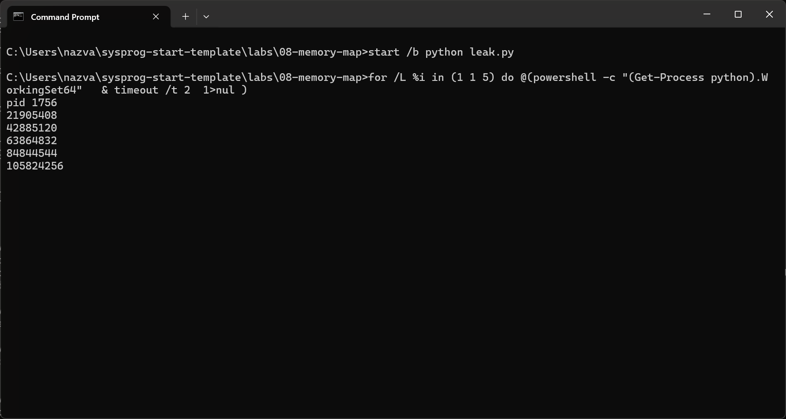

# ЛР 8. Карта памяти

Система: Windows 11 x64 (10.0.26200), процессор x64 (AMD64) · Python 3.14.6
Чем мерил (виртуальная и занятая): PowerShell `Get-Process python` — `VirtualMemorySize64` (обещано) и `WorkingSet64` (занято); VMMap (`vmmap64.exe`) — Committed / Size (обещано) и Working Set (занято). Процесс mem.py — PID 4048.

## Этапы mem.py
Старт: обещано 4 274 752 K (≈ 4,08 ГБ виртуальных адресов, VMMap Total Size; из них Committed 28 240 K) / занято 11 485 184 байт (≈ 11 МБ, WorkingSet64; в VMMap Working Set 11 212 K)
Получил 300 МБ: обещано 4 690 255 872 байт (≈ 4,37 ГБ, VirtualMemorySize64; VMMap Committed 335 440 K — +300 МБ) / занято 11 522 048 байт (≈ 11 МБ; VMMap Working Set 11 220 K — почти не изменилось)
Записал в каждую страницу: обещано 4 690 255 872 байт (VMMap Committed 335 440 K — не изменилось) / занято 326 098 944 байт (≈ 311 МБ; VMMap Working Set 318 424 K, из них Shareable 307 484 K)
Освободил: обещано 4 375 683 072 байт (≈ 4,08 ГБ, как на старте) / занято 11 530 240 байт (≈ 11 МБ)
Почему занятая память выросла только на третьем этапе: `mmap` на втором этапе только резервирует адреса и обещает (commit) 300 МБ — физических страниц ещё нет. Настоящая память выделяется страница за страницей при первой записи в неё (page fault), поэтому Working Set вырос только после записи в каждую страницу.

## Карта памяти
Из каких частей состоит память процесса: по VMMap на старте: Heap (Size 5 008 K), Image — exe и DLL (20 968 K), Mapped File (2 552 K), Private Data (4 231 332 K, почти всё — зарезервированные адреса), Shareable (1 492 K), Stack (11 776 K), Unusable (1 624 K); всего Total 4 274 752 K, Committed 28 240 K, Private Bytes 5 796 K, Working Set 11 212 K. 300 МБ от `mmap` попали в строку Shareable (308 692 K после получения).

## Утечка
Пять замеров leak.py: 21 905 408, 42 885 120, 63 864 832, 84 844 544, 105 824 256 байт
На сколько росла память за 2 секунды: на 20 979 712 байт ≈ 20 МБ (по 10 МБ в секунду)

Не получилось: VirtualMemorySize64 на старте на экране не сохранился (окно PowerShell было закрыто окном VMMap), поэтому «обещано» на старте взято из VMMap. В VMMap процесс выбран по номеру (`-p 4048`), а не по имени `python`, потому что в системе работали и другие процессы Python. Команды выполнял ИИ из командного файла.

ИИ: работа выполнена с помощью ИИ-ассистента Claude (запуск команд, снимки ShareX, заполнение отчёта).

## Снимки экрана

Сохраните снимок поверх заглушки в папке `screenshots/` с тем же именем — ссылки ниже менять не нужно.

### 1. Карта памяти
Шаг 2. Видно: карта памяти процесса mem.py на старте и её итог.

### 2. Получено 300 МБ
Шаг 3. Видно: виртуальная память выросла на 300 МБ, занятая — нет.

### 3. Страницы заняты
Шаг 4. Видно: занятая память (в macOS — физический след) после записи в каждую страницу.

### 4. Утечка
Шаг 6. Видно: пять замеров памяти leak.py.

